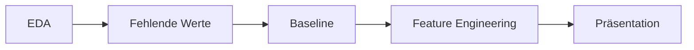

# Urbane Luftverschmutzung: Feinstaub schätzen, wo keine Messstation steht

Machine-Learning-Projekt zur [Zindi Urban Air Pollution Challenge](https://zindi.africa/competitions). Ein Modell schätzt die tägliche Feinstaubbelastung (PM2.5, µg/m³) eines Ortes allein aus frei verfügbaren Satelliten- und Wetterdaten. Entscheidend ist, dass es auf Orte übertragbar ist, die es im Training nie gesehen hat.

## Ergebnis in Kürze

| Modell | Features | RMSE | R² |
| --- | --- | --- | --- |
| Globaler Mittelwert | – | 47,1 | −0,01 |
| Mittelwert pro Datum | – | 46,7 | 0,01 |
| Ridge-Regression | 76 | 38,0 | 0,34 |
| Gradient Boosting, Rohfeatures | 76 | 33,4 | 0,49 |
| Gradient Boosting, alle neuen Feature-Gruppen | 142 | 30,2 | 0,58 |
| **Gradient Boosting, Top 20 nach Permutation Importance** | **20** | **30,3** | **0,58** |

Alle Werte stammen aus 5-facher `GroupKFold`-Validierung nach `Place_ID`, bei der jeweils ganze Orte zurückgehalten werden.

- **Orts-Profile sind der wichtigste Baustein.** Mittelwert und Streuung der Satelliten- und Wetterwerte pro Ort tragen rund 70 % der Permutation Importance. Sie geben dem Modell ein Profil des Ortes, ohne die Ortskennung zu verwenden.
- **20 Features reichen aus.** Das kleine Set ist praktisch so gut wie alle 142.
- **Hyperparameter-Tuning bringt wenig.** In verschachtelter Cross-Validation liegt der Gewinn bei 0 bis 0,25 RMSE und damit weit unter der Streuung zwischen den Folds (etwa 4).
- **Spitzenwerte bleiben die Schwachstelle.** Bei Tageswerten über 200 µg/m³ liegt die Schätzung im Mittel rund 100 µg/m³ daneben. Das Modell eignet sich als Screening, nicht als Warnsystem.

## Daten

Die Daten liegen in [data/](data/) und stammen aus dem Zindi-Wettbewerb (PM2.5-Messwerte und Wetter, Satellitendaten von Sentinel-5P).

| | Train | Test |
| --- | --- | --- |
| Zeilen (Ort × Tag) | 30.557 | 16.136 |
| Orte | 340 | 179 |
| Zeitraum | 02.01. bis 04.04.2020 | 02.01. bis 04.04.2020 |

- **Target:** `target`, das Tagesmittel von PM2.5 pro Ort.
- **Features:** 74 Spalten, davon 6 Wetter- und 68 Satellitenwerte (Produkte AER, CH4, CLOUD, CO, HCHO, NO2, O3, SO2).
- **Keine gemeinsamen Orte** in Train und Test. Deshalb wird überall nach `Place_ID` gruppiert validiert, ein zufälliger Split wäre zu optimistisch.
- **Leakage:** `target_min`, `target_max`, `target_variance` und `target_count` gibt es nur in Train, sie werden nicht verwendet.
- **Fehlende Werte:** Die Wetterdaten sind vollständig, die Satellitendaten lückenhaft (bei CH4 fehlen etwa 81 %).

## Notebooks

Die Notebooks bauen in dieser Reihenfolge aufeinander auf:



| Notebook | Inhalt |
| --- | --- |
| [eda.ipynb](eda.ipynb) | Meilenstein 1: Problemstellung, Datenqualität, Verteilung des Targets, Zeit- und Ortseffekte, Vergleich von Train und Test. |
| [interpolation.ipynb](interpolation.ipynb) | Füllt Lücken in den Satellitendaten per Forward- und Backward-Fill innerhalb eines Ortes und schreibt `Train_filled.csv` und `Test_filled.csv`. |
| [meilenstein2.ipynb](meilenstein2.ipynb) | Meilenstein 2: Baselines (Mittelwerte, Ridge, Gradient Boosting) und erste Fehleranalyse. |
| [feature_engineering.ipynb](feature_engineering.ipynb) | Meilenstein 3: Feature-Gruppen bauen, per Ablation bewerten und mit verschachtelter Permutation Importance das finale Set aus 20 Features wählen. |

## Weitere Ordner und Dateien

| Datei / Ordner | Beschreibung |
| --- | --- |
| [data/](data/) | `Train.csv`, `Test.csv`, `SampleSubmission.csv` sowie die aufgefüllten Varianten `Train_filled.csv` und `Test_filled.csv`. |
| [models/](models/) | Ausgewählte Features (`fe_selected_features.json`, `fe_alle_features_selected_features.json`) und beste Hyperparameter der Zufallssuche (`gb_best_params_*.json`). |
| [Präsentation/](Präsentation/) | Präsentation für Stakeholder und der einseitige Produktvorschlag „Messnetz-Planer“ (PDF). |
| [test_target.csv](test_target.csv) | Vorhersagen für die Test-Orte im Format der Zindi-Submission. |
| [pyproject.toml](pyproject.toml), [uv.lock](uv.lock) | Abhängigkeiten des Projekts. |

## Datenprodukt: Messnetz-Planer

Aus dem Modell leitet sich ein Vorschlag für Umweltverwaltungen ab: eine Karte und Rangliste der Orte, die vermutlich hoch belastet sind, aber bisher keine Messstation haben. Damit lassen sich Standorte für neue Stationen und mobile Messkampagnen gezielter wählen.

Grenzen des Ansatzes:

- Kein Warnsystem, weil Spitzentage deutlich unterschätzt werden.
- Keine Prognose, weil das Modell die Satellitendaten desselben Tages braucht.
- Kein Ersatz für Messstationen.
- Ein Ort braucht eine längere Datenreihe (im Training rund 90 Tage), damit sein Profil berechnet werden kann.

Details stehen in den PDFs im Ordner [Präsentation/](Präsentation/).

## Setup

Voraussetzungen sind [uv](https://docs.astral.sh/uv/getting-started/installation/) ab Version 0.13.5 und Python 3.13 (siehe [.python-version](.python-version)).

```bash
git clone git@github.com:RealCyron/Machine_Learning_Projekt.git
cd Machine_Learning_Projekt
uv sync
```

Danach den Projektordner in VS Code öffnen (`code .`), ein Notebook öffnen und die von `uv sync` erstellte Umgebung (`.venv`) als Kernel wählen. Die Notebooks erwarten die Daten im Ordner `data/` und werden aus dem Projektordner heraus ausgeführt.

## Lizenz

Siehe [LICENSE](LICENSE).
